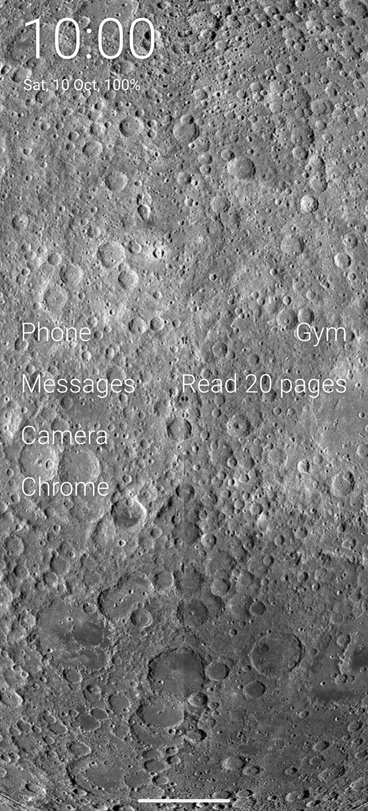
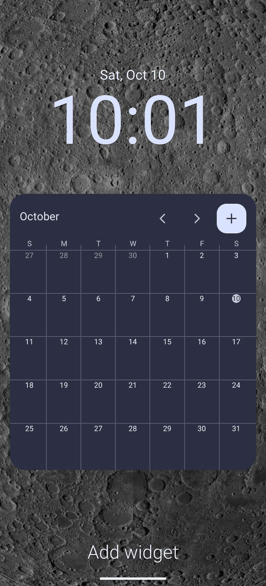
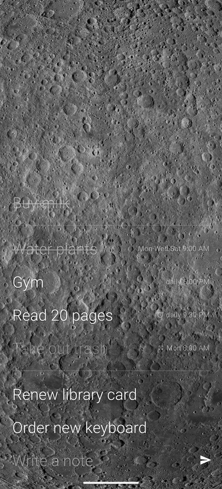
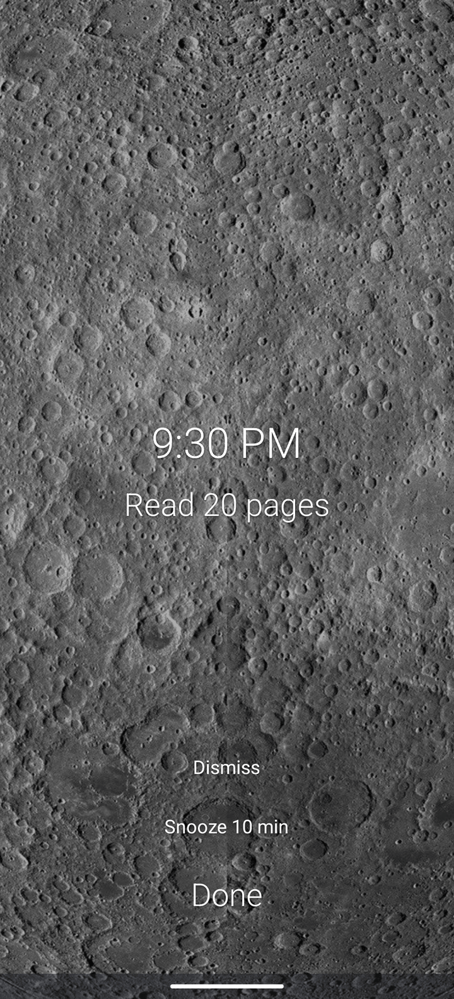

# JezLauncher

A minimalist Android launcher with a few useful extras: a widget wall, notes with reminders, and a daily wallpaper. No ads, no analytics, no accounts.

JezLauncher is a fork of [Olauncher](https://github.com/tanujnotes/Olauncher) by tanujnotes. It keeps Olauncher's text-only home screen and adds the things that were missing for daily use: a place for widgets and a notes screen that can remind you.

<p align="center">
  
  
  
  
</p>

## Features

**Minimalist base (from Olauncher)**
- Text-only home screen with a short list of apps, app drawer with search, hidden apps, renaming, work profile and Private Space support.
- Swipe gestures, double tap to lock (optional), light and dark themes.

**Widget wall**
- Swipe right on the home screen to open a wall for regular Android widgets (the swipe can be turned off in settings).
- 4-column grid. Long press to enter edit mode, drag a widget to move it, drag its edges to resize it. Widgets in the way move down.
- Works with third-party widgets that use the standard widget API, including their configuration screens.

**Notes**
- Swipe left to open the notes screen: add a note, strike it through when done, drag to reorder.
- Scheduled notes: one-off, daily or weekly (pick the weekdays) at a set time.
- Three alert types per note:
  - *Notification* - a normal notification that sounds once.
  - *Full screen* - opens over the lock screen and sounds once.
  - *Alarm* - opens full screen and rings until you tap Done, Snooze (10 minutes) or Dismiss.
- Daily and weekly notes reset by themselves when the next period starts. They stay in a separate routine section, and notes that are still to do can show on the home screen.
- Alerts are re-armed after a reboot, an app update, and a clock or time zone change.

**Wallpaper**
- Daily wallpaper from NASA's Astronomy Picture of the Day (default) or your own feed URL. See [Wallpaper](#wallpaper).
- Optional; off by default. Turn it on in settings.
- JezLauncher is not affiliated with NASA.

**Home screen text colour**
- The home screen text colour is taken from the wallpaper's own colours and kept readable on it.

## Install

- **GitHub Releases:** download the APK from the [latest release](https://github.com/hakunokina/jezlauncher/releases/latest) and install it. Android asks you to allow installs from your browser or file manager the first time.
- **F-Droid:** planned, not available yet.

Requires Android 7.0 (API 24) or newer. Application id: `io.github.hakunokina.jezlauncher`.

After installing, press the home button and choose JezLauncher as the default home app.

## Permissions

Everything beyond the basics is used for one feature only.

| Permission | Why |
|---|---|
| `QUERY_ALL_PACKAGES` | List the installed apps for the home screen and app drawer. |
| `REQUEST_DELETE_PACKAGES` | Ask Android to uninstall an app when you choose "uninstall" in the drawer. Android still asks you to confirm. |
| `EXPAND_STATUS_BAR` | Open the notification shade from a gesture. |
| `SET_ALARM` | Open the clock app's alarm list. JezLauncher does not set alarms in it. |
| `PACKAGE_USAGE_STATS` | Show your screen time on the home screen. Granted by you in *Usage access* settings; optional. |
| `ACCESS_HIDDEN_PROFILES` | Show apps in Private Space on Android 15 and newer. |
| `SET_WALLPAPER` | Apply the daily wallpaper. |
| `INTERNET` | Download the daily wallpaper (NASA APOD from science.nasa.gov, or your feed) and its images. Nothing else uses the network. |
| `POST_NOTIFICATIONS` | Show note reminders (Android 13+). |
| `SCHEDULE_EXACT_ALARM` | Fire note reminders at the exact time you set. |
| `USE_FULL_SCREEN_INTENT` | Open *Full screen* and *Alarm* notes over the lock screen. |
| `RECEIVE_BOOT_COMPLETED` | Re-arm note reminders after a reboot, update, or clock change. |
| `VIBRATE` | Vibrate for note alerts. |

Optional, off until you enable them:
- **Accessibility service** - used only for the double-tap-to-lock gesture (it performs the system "lock screen" action). See [Double tap to lock](#double-tap-to-lock).
- **Device administrator** (`force-lock` only) - the same gesture on Android 8 and older.

## Double tap to lock

1. Open settings (long press on the home screen) and tap **Double tap to lock**.
2. Read the note and tap **Enable**. Android's accessibility settings open.
3. Turn on the **JezLauncher** service. Double tap an empty part of the home screen to lock the phone.

If it does not work:
- **"Restricted setting"** (Android 13 and newer, APK installed from a browser or file manager): open the app info of JezLauncher, tap the ⋮ menu, choose **Allow restricted settings**, then turn the service on again.
- Some phones turn accessibility services off after an update or to save battery. Turn the service on again, and exclude JezLauncher from battery optimisation if the phone keeps doing it.
- On Android 8 and older the gesture uses device administrator instead; Android asks you to activate it the first time.

The service does nothing but the lock action. It does not read, store or send screen content.

## Wallpaper

Turn on **Daily new wallpaper** in settings. The **Wallpaper URL** row picks the source.

### NASA APOD (default)

With an empty Wallpaper URL the image comes from [NASA's Astronomy Picture of the Day](https://science.nasa.gov/apod/), which now lives on science.nasa.gov:

- At most one answered request a day: the ten latest APOD posts from science.nasa.gov (its public WordPress API, no key). The old `api.nasa.gov` APOD API is not used; it no longer returns the pictures.
- The newest post that fits is used. Skipped: posts that mention a copyright (APOD marks those images "Credit & Copyright"; they belong to their authors), posts without a credit line, videos, images shorter than 1080 pixels on their short side or more than twice as wide as high, and files over 25 MB.
- Settings show the title and credit of the current APOD image under **Wallpaper URL**; tap it to open the APOD page. Many images, such as those from Hubble and Webb, ask for this credit.
- The same image is used in light and dark mode; the home screen text colour adapts to it.
- If there is no network or science.nasa.gov does not answer, the current wallpaper stays and the app tries again on its next periodic check (about every four hours). If none of the posts fits, the current wallpaper stays until the next day.

Check [APOD's image permissions](https://science.nasa.gov/apod/) and the credit line before reusing an image elsewhere.

### Your own feed

To use your own images, set a **Wallpaper URL** in settings. It must be an `https` URL that returns JSON like this:

```json
{
  "url": "https://example.com/wallpapers/today-light.jpg",
  "dark": "https://example.com/wallpapers/today-dark.jpg",
  "items": [
    "https://example.com/wallpapers/a-light.jpg",
    "https://example.com/wallpapers/b-light.jpg"
  ],
  "dark_items": [
    "https://example.com/wallpapers/a-dark.jpg",
    "https://example.com/wallpapers/b-dark.jpg"
  ]
}
```

| Field | Required | Meaning |
|---|---|---|
| `url` | yes | Image of the day for the light pool. Must be `https`. |
| `dark` | no | Image of the day for the dark pool. Falls back to `url` if missing or invalid. |
| `items` | no | List of `https` images for the "next wallpaper" action (triple tap on the home screen) in the light pool. |
| `dark_items` | no | Same for the dark pool. Falls back to `items`. |

Rules:
- Light or dark pool is chosen by the local time: dark from 19:00 up to 05:00, light otherwise. The system dark mode is not used for a custom feed.
- The image of the day is applied once when its URL changes, and when the pool switches at 19:00 or 05:00. The feed is checked about every four hours while the daily wallpaper is on. A wallpaper you pick manually stays until the next change.
- Entries that are not `https` URLs are ignored. Unknown fields are ignored.
- The image is scaled to cover the screen and set as both home and lock wallpaper.

Long press **Wallpaper URL** to check the source right away. Long press **Daily new wallpaper** to turn it off and go back to a plain wallpaper.

## Build from source

Requirements: JDK 17, Android SDK (compile SDK 36).

```sh
git clone https://github.com/hakunokina/jezlauncher.git
cd jezlauncher
./gradlew :app:assembleDebug      # installs next to a release build (".debug" id suffix)
./gradlew :app:testDebugUnitTest  # unit tests
```

`assembleRelease` builds an unsigned APK unless the signing properties `JEZ_STORE_FILE`, `JEZ_STORE_PASSWORD`, `JEZ_KEY_ALIAS` and `JEZ_KEY_PASSWORD` are set as Gradle properties.

## Optional: OpenSkyLight kiosk sync

Notes can sync both ways with a list on an OpenSkyLight kiosk in your Tailscale tailnet. It is off in the published builds: build with `./gradlew assembleRelease -Pjezlauncher.kioskSync=true` to get **Settings → Kiosk sync** (scan the kiosk's QR code, choose a list). The kiosk needs OpenSkyLight's companion sync API and the phone Tailscale; the traffic is plain http inside the tailnet (encrypted by WireGuard), allowed only to the paired tailnet host. See [docs/KIOSK_SYNC.md](docs/KIOSK_SYNC.md).

## Privacy

No analytics, crash reporting, advertising or tracking libraries, and no accounts. Notes, layout and settings stay on your device. The network is used only for the daily wallpaper. Details: [PRIVACY.md](PRIVACY.md).

## Changes

As the GPL asks, this is what JezLauncher changes compared with upstream Olauncher (forked from v6.9.17 on 2026-10-03):

- 2026-10-03 to 2026-10-10:
  - Added the widget wall (4-column grid, edit mode, move, resize).
  - Added the notes screen: strike-through, reordering, daily, weekly and one-off schedules; notification, full screen and alarm alerts; routine section and notes on the home screen.
  - Added the "interrupt apps" pause before opening chosen apps, and bottom bar apps.
  - Made the home screen text colour follow the wallpaper.
  - Replaced the wallpaper source with NASA APOD or a user-provided feed.
  - Removed the in-app review, rating, sharing and other-app prompts.
  - Renamed the app to JezLauncher with the application id `io.github.hakunokina.jezlauncher`.
- 2026-10-11:
  - Added an optional two-way sync of the notes with an OpenSkyLight kiosk list, off unless built with `-Pjezlauncher.kioskSync=true`.


## Credits and license

Olauncher © Tanuj M. and contributors. Modifications © hakunokina.

JezLauncher is based on [Olauncher](https://github.com/tanujnotes/Olauncher) by tanujnotes, with thanks for that work. The Olauncher name and branding belong to the original author; JezLauncher is an independent fork and is not affiliated with or endorsed by the original project.

This program is free software: you can redistribute it and/or modify it under the terms of the GNU General Public License version 3 (GPL-3.0-only), see [LICENSE](LICENSE). It comes with no warranty. The complete source of every release is in this repository.
